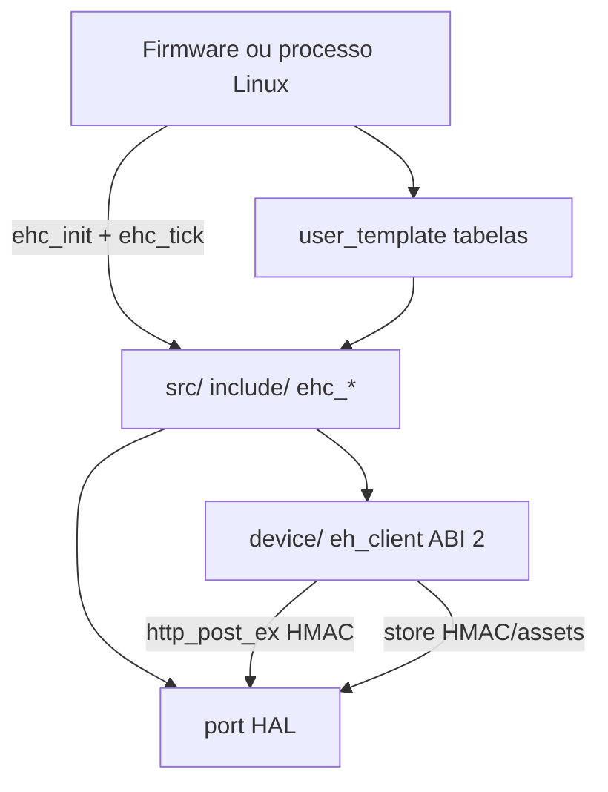

# Arquitectura do Client SDK

Contrato HTTP: [PROTOCOL.md](PROTOCOL.md). API: [API.md](API.md). HAL: [PORTING.md](PORTING.md).

## Camadas

O núcleo **não** se duplica por plataforma. Troca-se o port (`ehc_port_t`) e o ficheiro de RNG Ed25519.

```
edgehub-client-sdk 0.3.3
  device/                 protocolo ABI 2 (1.2.6) — `eh_client_*`
  include/edgehub_client/ API pública `ehc_*`
  src/                    prontidão, tabelas, bridge para o device
  port/{host_stub,linux,esp32,embedded}/
  user_template/          tabelas do produto — **não** ligar à `.a`
  examples/{linux_demo,esp32_demo,embedded_stub}/
  tests/                  Unity + CTest (host)
  docs/                   contrato partilhável (este directório)
  releases/v0.3.2/        SYNC, MANIFEST, release notes
```



CMake host: `add_subdirectory(device)` com `EHC_DEVICE_SDK_ROOT` default `${repo}/device`. Não é preciso um repo irmão `edgehub-device-sdk`. Firmwares consomem **este** repo como submodule. `scripts/sync_device_sdk.ps1` está **deprecado**.

## Versões e ABI

| Peça | Valor | Onde |
|------|-------|------|
| Umbrella | `0.3.3` | `VERSION`, `EHC_LIB_VERSION` em `ehc.h` |
| Device | `1.2.6` | `device/VERSION`, `EH_LIB_VERSION_*` |
| ABI | `2` | `EH_LIB_ABI_VERSION` |

`ehc_init` chama `eh_lib_abi_check()` **primeiro**. Compara `sizeof(eh_config_t)`, `sizeof(eh_client_t)`, `sizeof(eh_callbacks_t)`, `sizeof(eh_client_status_t)` e ABI. Mismatch → `EHC_EABI`. Header e objectos **têm** de nascer no mesmo compile: `-DEH_MAX_TELEMETRY_QUEUE_VALUES=4096` muda o tamanho de `eh_client_t`.

ABI 2 (desde device 1.1.0): `eh_config_t` ganhou `telemetry_batch_max` / `telemetry_queue_capacity` / `telemetry_queue_persist`; `eh_client_t` inclui a fila de leituras. 1.2.4 acrescentou `credential_expires_at_ms` em `eh_client_t` (continua ABI 2 — recompile header+lib juntos). `http_post` não muda de assinatura; `http_post_ex` é opcional no **fim** de `eh_callbacks_t` (firmware antigo deixa NULL).

Parser JSON: `device/src/internal/eh_json.c`. **Não** se compila `vendor/cjson` (desde 1.2.1) — evita colisão com o componente `cJson` do ESP-IDF.

## Quem faz o quê

| Camada | Responsabilidade | Não faz |
|--------|------------------|---------|
| `device/` | URLs, HMAC, JSON canónico, fila RAM, `pendingCommands`, `credential/issue`, backoff, Ed25519 | GET OTA, SNTP, NVS de produto, overlays de config |
| `src/` | Prontidão, tabelas estáticas, `disable_*`, persistir HMAC/assets via port, defer de comandos | Duplicar HTTP |
| `port/` | HTTPS, flash, `now_ms`, lock, log | Interpretar JSON EdgeHub |
| Aplicação | Tabelas, `on_download` (GET+SHA256), SNTP, glue NVS, overlay de config | Assinar HMAC à mão |

## Loop

```c
ehc_init(&port, &user);
for (;;) {
  ehc_tick();
}
```

Ordem **dentro** de `ehc_tick` (com `ehc_lock` reentrante):

1. `ehc_refresh_readiness()`. Se `UNCONFIGURED` → log throttled (`EHC_NOT_READY_LOG_MS` = 60 s) e `EHC_ENOTREADY`. **Não** chama `eh_client_init`.
2. `ehc_ensure_eh_client()` (lazy `eh_client_init` + load HMAC + PKCS#8).
3. `eh_client_tick(now)` — check-in (drift / reprovision / intervalo), telemetria automática se `telemetry_manual_only=0`.
4. `ehc_persist_secret_if_changed()`.
5. Se slave `poll_commands`: **re-lê** `ehc_now()` e `eh_client_poll_downlink`.
6. Se master ACTIVE e fila RAM > 0 e não `telemetry_manual_only`: `eh_client_flush_telemetry`.
7. `ehc_run_deferred()` (handlers `EHC_CMD_DEFER_AFTER_ACK` **depois** do `executed`).

Falha de check-in **não** impede a telemetria do mesmo `eh_client_tick` (o backoff aplica-se no tick seguinte).

## Prontidão (`ehc_readiness_t`)

| Estado | Condição | Rede |
|--------|----------|------|
| `EHC_UNCONFIGURED` | falta `base_url` ou `device_uid` ou key `EHC_KEY_REQUIRED` | nenhum HTTP |
| `EHC_MINIMAL` | URL+UID OK; falta `group_key` **ou** `product_code` | check-in mínimo (pending) |
| `EHC_FULL` | group+product OK; sem HMAC ou provisioning ≠ `active` | check-in completo; telemetria **não** POST |
| `EHC_ACTIVE` | HMAC presente **e** `eh.provisioning == EH_PROV_ACTIVE` | ingest + executed |

Antes de ACTIVE, `ehc_tel_enqueue` / `ehc_tel_publish` **enfileiram**; `ehc_tel_flush` devolve OK e a fila fica. `ehc_tel_*` com `disable_telemetry=1` → `EHC_ENOTREADY`.

Razões em `ehc_not_ready_reason()`: `missing base_url`, `missing device_uid`, `missing required check-in key`, `waiting group_key+product_code`, `waiting hmac secret`, `waiting hmac secret reprovision`, `waiting provisioning active`.

## Storage (chaves opacas)

| Chave | Quem escreve | Conteúdo |
|-------|--------------|----------|
| `ehc.hmac.secret` | client após `credential/issue` | secret actual (string + NUL) |
| `ehc.hmac.secret.prev` | client ao rodar | secret anterior (janela `rotateGraceUntil`) |
| `ehc.asset.<assetKey>` | client se `on_config_apply` devolver sucesso | versão string |
| `eh.tel.q` | **ignorada** | bridge: read = vazio; write = no-op (`telemetry_queue_persist=0`) |

Identidade (`base_url`, UID, group, product, PKCS#8) **não** vai a estas chaves — resolve-se por `EHC_IDENT_LIT` / `STORE` / `FN`.

## RAM compile-time

Defaults **públicos** do device (não mudar no header publicado sem recompilar tudo):

| Define | Default | Notas |
|--------|---------|-------|
| `EH_MAX_TELEMETRY_QUEUE` | 16 | slots RAM; master típico **8**, slave **1** |
| `EH_MAX_TELEMETRY_QUEUE_VALUES` | 768 | bytes JSON `values` por slot; JSON ~4 KiB → **4096** |
| `EH_MAX_BATCH_PAYLOAD` | 65536 | body + canónico HMAC no heap; **não** descer para 32 KiB (lote ~34 KB) |
| `EH_MAX_COMMANDS` | 5 | cap alinhado com `TELEMETRY_DOWNLINK_MAX_COMMANDS` do servidor |
| `EH_MAX_PAYLOAD` | 4096 | body check-in |
| `EH_MAX_RESPONSE` | 8192 | resposta check-in (heap, não stack da task MDM) |
| `EH_MAX_COMMAND_PAYLOAD` | 1024 | JSON `payload` de um comando |
| `EH_MAX_CHECKIN_CONFIG_PAYLOAD` | 4096 | `payload` por configuration |
| `EH_MAX_SECRET` | 128 | HMAC |

O `.a` pré-compilado com `QUEUE_VALUES=768` **não** serve para JSON ~4 KiB. Compilar **fontes** `device/` com os `-D` no mesmo TU que inclui `edgehub_device.h`. Os defines têm de ser **PUBLIC** em todos os TUs.

Client (`ehc_config_defaults.h` / `ehc_user_config.h`):

| Define | Default |
|--------|---------|
| `EHC_MAX_METRICS` | 64 |
| `EHC_MAX_COMMANDS_TABLE` | 32 |
| `EHC_MAX_CHECKIN_KEYS` | 24 |
| `EHC_TEL_STR_MAX` | 32 |
| `EHC_TEL_STR_SLOTS` | 8 |
| `EHC_OBJECT_SCRATCH_BYTES` | 256 |
| `EHC_MAX_NESTING_DEPTH` | 2 |
| `EHC_CHECKIN_INTERVAL_MS` | 43200000 (12 h) |
| `EHC_TELEMETRY_INTERVAL_MS` | 10000 |
| `EHC_TELEMETRY_BATCH_MAX` | 1 |
| `EHC_COMMAND_POLL_INTERVAL_MS` | 60000 |
| `EHC_CTX_ATTR` | vazio; ESP32+PSRAM: `section(".ext_ram.bss")` |

`g_ehc` pode ir a PSRAM via `EHC_CTX_ATTR` em `ehc_user_config.h` + `-DEHC_USER_CONFIG_HEADER="ehc_user_config.h"`. Sem o define, BSS normal. WROOM 4 MB: **não** definir `EHC_CTX_ATTR`.

## Device `eh_client_init` defaults

Se os três `enable_checkin/telemetry/commands` forem 0, a lib **re-liga os três**. Por isso `ehc_init` recusa os três `disable_*` a 1 (`EHC_ECONFIG`). Outros defaults device: `checkin_interval_ms=60000` se 0 (o client passa 12 h); `telemetry_interval_ms=10000`; `backoff_initial_ms=2000`; `backoff_max_ms=60000`; `checkin_on_keys_change=1`.

O client força: `enable_auto_confirm_commands=1`, `telemetry_queue_persist=0`, `checkin_on_keys_change=1`.

## Media / WHIP

**Não implementado** nesta árvore. Firmware que queira WHIP faz o POST à parte.

## Anti-padrões

- Duplicar `src/` ou `device/` por MCU.
- `add_subdirectory` da **raiz** deste repo dentro de um projecto ESP-IDF (`project()` host parte o configure) — usar `third_party/` + CMake wrapper, não `components/edgehub-client-sdk`.
- Ligar `user_template/*.c` à `.a` da lib.
- Meter overlay de config do produto, NVS legado ou SNTP nesta lib.
- Inventar GET público de comandos.
- Tratar HTTP 401 de aplicação como falha de transporte.
- Assinar o body cru de telemetria (falta `alias:""` no canónico).
