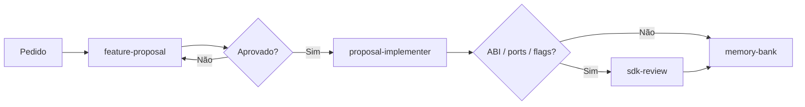

# Playbook de agentes — EdgeHub Client SDK

Prompts para copiar no chat. Ajuste o escopo entre `<<<` e `>>>`.

---

## 1. Nova feature — proposta (sem código)

```
@feature-proposal

Pedido: <<< descreva o pedido >>>

Contexto: <<< ports, ABI, flags, firmware, CMake >>>

Produz proposta com escopo, critérios de aceite, ficheiros, riscos e
plano de validação (test_host.ps1 -DeviceSdk). Não escrevas código.
```

---

## 2. Implementar após aprovação

```
@proposal-implementer

Aprovado: <<< resumo do que foi aprovado >>>

Implementa exatamente o aprovado. Respeita AGENTS.md e .cursor/rules/.
Escopo mínimo. Não commits sem pedido. Responde em português.
```

---

## 3. Plano multi-etapa

```
Cria um plano em .cursor/plans/<nome>.plan.md com todos rastreáveis.
Objetivo: <<< objetivo >>>
Não implementes ainda — só o plano.
```

---

## 4. Revisão do SDK (só leitura)

```
@sdk-review

Revisa <<< branch / ficheiros >>>.
Foco: ABI device, flags disable_*, HTTP 401 vs transporte, colisão CTest,
duplicação de núcleo por plataforma, glue EcoCircuito nesta lib.
Lista achados por severidade. Não alteres código.
```

---

## 5. Port novo / Linux / ESP32 / MCU

```
Skill ehc-porting.

Alvo: <<< linux | esp32 | MCU >>>
Segue docs/PORTING.md e a rule ehc-ports. Não dupliques src/ nem device/.
```

---

## 6. Atualizar memória ao fechar

```
@memory-bank

Tarefa concluída: <<< resumo >>>
Atualiza a memória de sessão no vault 90 - Agent Workspace/EdgeHub/Client SDK
(active-context.md, progress.md e lessons.md, se aplicável). Não dupliques AGENTS.md nem docs/.
```

---

## Fluxo típico


