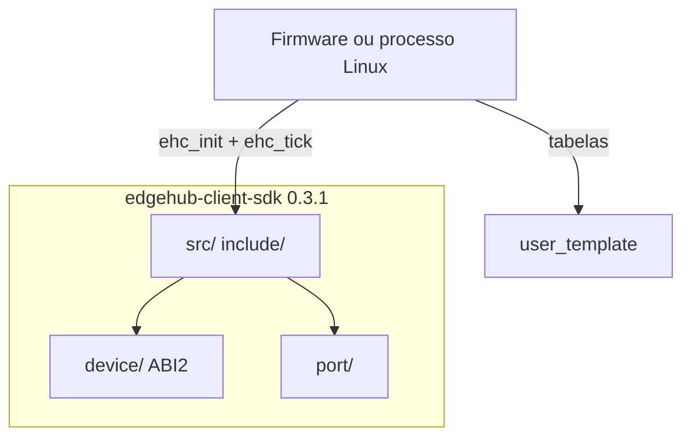

# System Patterns

> Arquitetura resumida — detalhe em `docs/INTEGRATION.md`, `docs/PORTING.md`.

## Visão geral

```
edgehub-client-sdk 0.3.1
  device/          protocolo ABI 2 (1.2.5)
  src/ include/    camada produto (ehc_*)
  port/            HAL (http, storage, now, lock)
    host_stub/     testes
    linux/         OpenSSL + ficheiros
    esp32/         IDF + NVS
    embedded/      stubs MCU
  user_template/   tabelas do produto (não na .a)
```



## Padrão: um port por alvo

O client **não** se duplica. Troca-se `ehc_port_t` + `ed25519_random*`.

| Alvo | Port | Random |
|------|------|--------|
| Testes | `port/host_stub` | `device/platform/ed25519_random_host.c` |
| Linux | `port/linux` | host |
| ESP32 | `port/esp32` | `examples/esp32_demo/main/ed25519_random_esp32.c` |
| MCU | `port/embedded` | `port/embedded/ed25519_random_embedded.c` (TRNG) |

CMake host: `-DEHC_PORT=host|linux|embedded|esp32`. ESP32 real = projecto IDF `examples/esp32_demo`.

## Padrão: consumo firmware

Um submodule (após 0.3.0): `components/edgehub_sdk` → este repo.

- Device: `EH_SDK_DIR=../edgehub_sdk/device`
- Client: `src`, `include`, `port/esp32`
- Overlay EcoCircuito: `config.apply` / NVS legado **fora** desta lib

Boot: `lib=1.2.5 client=0.3.1 abi=2`.

## Padrão: features a menos

`memset(&user,0)` = master. Slave: `disable_telemetry=1`, `metric_count=0`. `ehc_init` recusa os três `disable_*` a 1. Slave com comandos MDM: `poll_commands=1` (POST `{values:{}}` no ingest). RAM (`EH_MAX_*`) no CMake do firmware.
